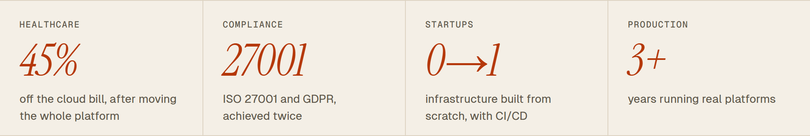

<a href="https://azlanmalik.com">
  <picture>
    <source media="(prefers-color-scheme: dark)" srcset="assets/banner-dark.png">
    
  </picture>
</a>

  <a href="https://azlanmalik.com"><picture><source media="(prefers-color-scheme: dark)" srcset="assets/btn-site-dark.png"></picture></a>
  <a href="https://www.linkedin.com/in/azlanmalik"><picture><source media="(prefers-color-scheme: dark)" srcset="assets/btn-linkedin-dark.png"></picture></a>
  <a href="https://x.com/azlan_dev"><picture><source media="(prefers-color-scheme: dark)" srcset="assets/btn-x-dark.png"></picture></a>
  <a href="https://www.threads.com/@azlan.malik"><picture><source media="(prefers-color-scheme: dark)" srcset="assets/btn-threads-dark.png"></picture></a>

<a href="https://azlanmalik.com/work/">
  <picture>
    <source media="(prefers-color-scheme: dark)" srcset="assets/stats-dark.png">
    
  </picture>
</a>

### Now building

  <a href="https://useauton.com"><picture><source media="(prefers-color-scheme: dark)" srcset="assets/auton-dark.png"></picture></a>
  <a href="https://play.google.com/store/apps/details?id=com.munshiplus"><picture><source media="(prefers-color-scheme: dark)" srcset="assets/munshiplus-dark.png"></picture></a>

### Where I've worked

<table>
  <tr>
    <td width="44"></td>
    <td><b>Xceed365</b> · DevOps and AI platform engineer May 2026 to now</td>
    <td>Moved the whole platform to a new cloud: multi-tenant, highly available, ISO 27001 and GDPR. <a href="https://azlanmalik.com/work/xceed365-ai-platform/">Case study →</a></td>
  </tr>
  <tr>
    <td></td>
    <td><b>Sehat Kahani</b> · DevOps and data engineer Apr 2024 to May 2026</td>
    <td>Moved a healthcare platform to a new cloud, compliant and <b>45% cheaper</b>. <a href="https://azlanmalik.com/work/healthcare-cloud-cost/">Case study →</a></td>
  </tr>
  <tr>
    <td></td>
    <td><b>Neem</b> · DevOps engineer Mar to Nov 2024</td>
    <td>Ran the cloud environment for a banking-as-a-service platform. <a href="https://azlanmalik.com/work/neem-payments-platform/">Case study →</a></td>
  </tr>
  <tr>
    <td></td>
    <td><b>ZETSOL Technologies</b> · DevSecOps engineer May 2023 to May 2026</td>
    <td>Built infrastructure for several startups from scratch, with CI/CD and lower cloud bills. <a href="https://azlanmalik.com/work/startups-from-scratch/">Case study →</a></td>
  </tr>
</table>

Cloud migrations · Kubernetes · Terraform · CI/CD · Linux · ISO 27001 and GDPR · AI agents in operations. Notes from real work at <a href="https://azlanmalik.com/blog/">azlanmalik.com/blog</a>, reach me at <a href="mailto:hi@azlanmalik.com">hi@azlanmalik.com</a>.
