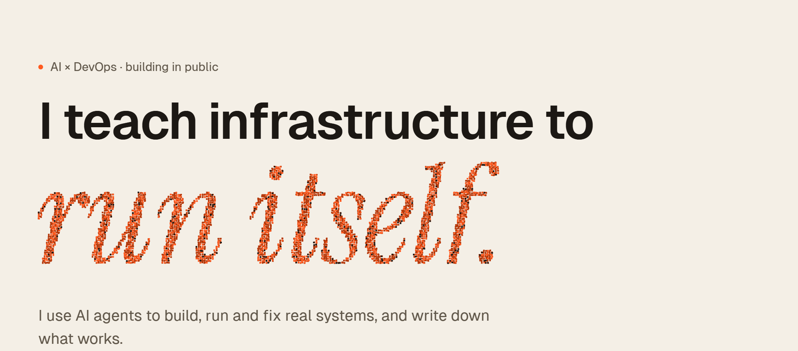
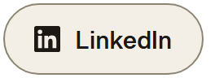
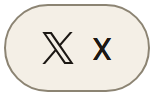
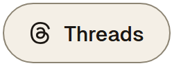
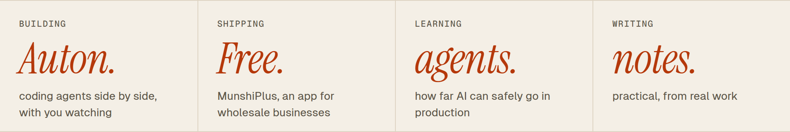
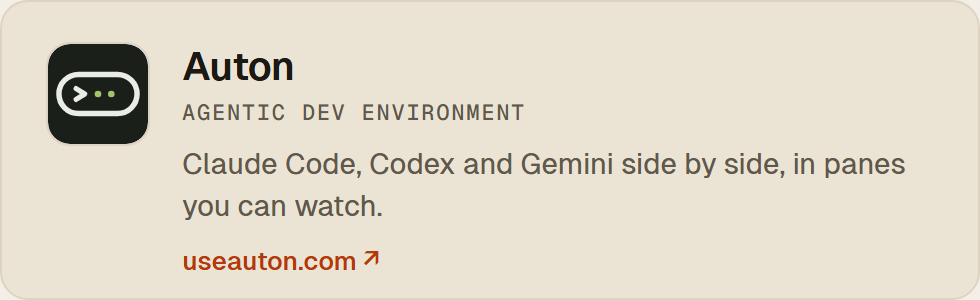
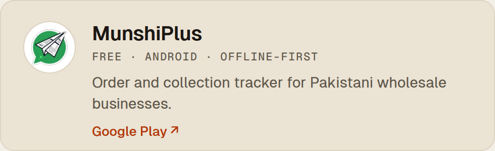

<a href="https://azlanmalik.com">
  <picture>
    <source media="(prefers-color-scheme: dark)" srcset="assets/banner-dark.png">
    
  </picture>
</a>

  <a href="https://azlanmalik.com"><picture><source media="(prefers-color-scheme: dark)" srcset="assets/btn-site-dark.png"></picture></a>
  <a href="https://www.linkedin.com/in/azlanmalik"><picture><source media="(prefers-color-scheme: dark)" srcset="assets/btn-linkedin-dark.png"></picture></a>
  <a href="https://x.com/azlan_dev"><picture><source media="(prefers-color-scheme: dark)" srcset="assets/btn-x-dark.png"></picture></a>
  <a href="https://www.threads.com/@azlan.malik"><picture><source media="(prefers-color-scheme: dark)" srcset="assets/btn-threads-dark.png"></picture></a>

<picture>
  <source media="(prefers-color-scheme: dark)" srcset="assets/now-dark.png">
  
</picture>

### Now building

  <a href="https://useauton.com"><picture><source media="(prefers-color-scheme: dark)" srcset="assets/auton-dark.png"></picture></a>
  <a href="https://play.google.com/store/apps/details?id=com.munshiplus"><picture><source media="(prefers-color-scheme: dark)" srcset="assets/munshiplus-dark.png"></picture></a>

### What I'm into lately

- **Agents on call.** Letting AI agents handle the boring part of operations, with a person approving anything they can't undo in one command.
- **Many agents, one task.** Running Claude Code, Codex and Gemini on the same problem and keeping the best attempt. Auton grew out of this.
- **Apps that work offline.** Building for a shop with a cheap phone and no signal. That's MunshiPlus.
- **Smaller cloud bills.** Finding the money a platform spends on things nobody uses.

### Ask me about

Moving a platform to a new cloud · ISO 27001 and GDPR without a binder · cutting cloud costs · putting AI agents to work in DevOps

Notes from real work at <a href="https://azlanmalik.com/blog/">azlanmalik.com/blog</a> · <a href="mailto:hi@azlanmalik.com">hi@azlanmalik.com</a>
